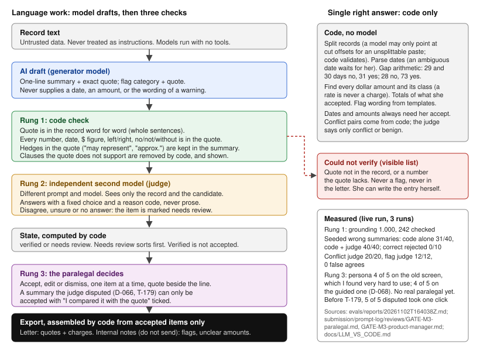

# Treatment timeline: medical records to a verified chronology

A prototype for a personal-injury paralegal: paste or upload medical records and get a dated treatment chronology, plus the treatment section of a demand letter, where **every statement is tied to a verbatim excerpt of the record**. Dates, gaps and bill totals are computed by code, a second, independent AI check double-checks each model answer, and **nothing reaches the letter until a person accepts it**.

**Synthetic data only.** The app shows a banner and refuses text it has not seen in demo mode. Never paste real patient or client records.

Ten minutes? Run it (below), do the 3-minute walk, then read "How the AI is checked".

## Run it

Needs **Python 3.12+** and git. No API key, no account, no network after the one-time install.

Get the code: `git clone https://github.com/borsheim-ai/zlayt-treatment-timeline.git && cd zlayt-treatment-timeline` (or unzip the download and `cd` into its folder). The repository is private, so ask Chris for access.

```
./run.sh
```

Open <http://127.0.0.1:7860>. The first run creates `.venv` and installs `requirements.txt` (the only slow step); later runs start in seconds. Stop it with Ctrl-C. Use another port with `PORT=7870 ./run.sh`.

Timed 2026-11-02 from a fresh `git clone` into an empty directory: 17 s to a healthy server with a cold pip download (Apple-silicon Mac, Python 3.12.2, fast network; details in [`deploy/TIMING.md`](deploy/TIMING.md)). Budget a few minutes on a slow network.

If `python3` on your machine is older than 3.12 (the macOS system Python is 3.9), `./run.sh` says so and stops. Point it at a newer one: `PYTHON=python3.12 ./run.sh`.

**Docker (optional, not verified by us).** The `./run.sh` path above is the one we tested. The Dockerfile exists, but the team's machine had no running Docker daemon, so `docker build` and `docker run` have never been executed; we emulated the image's file list and environment instead. If you want to try it and it fails, use `./run.sh`. The open item is recorded in [`submission/NEEDS_CHRIS.md`](submission/NEEDS_CHRIS.md) ("Docker verification").

```
docker build -t zlayt-demo .
docker run --rm -p 7860:7860 zlayt-demo        # http://127.0.0.1:7860
```

The image is meant to hold the app, the synthetic eval inputs and the committed LLM fixtures, and nothing else (`.dockerignore` is an allow-list; no `.env`, key or database). It runs as uid 1000, listens on `0.0.0.0:7860`, and has a health check on `/api/health`.

## The 3-minute walk (sample case)

The page opens on **Your cases**. Every screen after it shows four steps across the top: **Add records, Check the timeline, Check the bills, Get your letter**. These labels were checked against the running app on a fresh clone.

1. **Your cases.** With no cases yet, click **Open the sample case**.
2. **Step 1 of 4, "We found 9 records".** The nine synthetic records are listed with the dates the code read from them. Click **Draft the timeline**. When it finishes you should see "19 timeline items and 4 bill amounts are ready for you to check." (The badge "Prepared by our team" is demo mode; see below.) Click **Go to step 2: Check the timeline**.
3. **Step 2, Check the timeline.** Each item shows its exact excerpt under "From the record", and under "How it was checked" says which checks it passed. Answer all 19: **Yes, this matches** / **No, leave it out** / **Fix the wording** / **Decide later** for the 9 record lines, and **Yes, tell the attorney** / **No, not needed** for the 10 warnings (gaps, conflicts and the like, each with its evidence). When done you should see "You checked every item on the timeline." Click **Go to step 3: Check the bills**.
4. **Step 3, Check the bills.** Four amounts. For the two real charges answer **Yes, count it** / **No, don't count it**. A rate ($185) and a non-money figure are never added to the total; for those the buttons are **Yes, list it** / **No, leave it out** (listed ones go in the attorney notes). You should see "You checked every bill amount." and "Billed charges accepted from these records: $8,390.00". Click **Go to step 4: Get your letter**.
5. **Step 4, Get your letter.** You should see "Your letter is ready. Every item has an answer." **Copy letter** or **Download letter (.txt)** gives the treatment section for the demand letter (each line carries its verbatim source excerpt and an exhibit/Bates blank to fill in; each charge line also shows a "date of service [____]" blank to fill, because the tool takes no service date from the records); **Copy notes** or **Download notes (.txt)** is the internal note for the attorney. Only what you answered yes to is in the letter.

Try the checks yourself: on Step 2 choose **No, leave it out** for a line and watch it drop out of the letter; on Step 3 answer **No, don't count it** and watch the total change.

## How the AI is checked

Language and judgment (a one-line summary, "is this supported by the quote?", "do these two records conflict?") are model steps. Dates, gap arithmetic, quote matching, currency totals, sorting, de-duplication, schema checks and export assembly are plain code, never a model. Every model output then passes three rungs in order, and nothing a model produced reaches the letter without all three:



1. **Code check.** The excerpt must appear word for word in the record, every number, date and dollar figure in a summary must appear in the excerpt, the provider comes from the record's own source line. A failure is shown and never repaired; a rejected item cannot be exported. Code: [`app/backend/grounding.py`](app/backend/grounding.py), checks wired in [`app/backend/generator.py`](app/backend/generator.py) and [`app/backend/pipeline.py`](app/backend/pipeline.py), state rules in [`app/backend/confidence.py`](app/backend/confidence.py).
2. **Independent LLM judge.** A second model with a different prompt, by default a different (smaller) model, sees only the record and the candidate, never the generator's reasoning, and answers from a fixed list. If it cannot answer, the result is "unavailable", never "agree". Code: [`app/backend/judges.py`](app/backend/judges.py) (four judges: J1 faithfulness of a summary to its excerpt, J2 the class of each dollar amount, J3 conflicts, J4 flags), [`app/backend/judge_guard.py`](app/backend/judge_guard.py), [`app/backend/rejudge.py`](app/backend/rejudge.py). Models are set in `judges.py` (`GENERATOR_MODEL`, `JUDGE_MODEL` override the defaults).
3. **Human decision.** Even a fully verified item starts as pending; the paralegal accepts, edits or dismisses each one, and every action is stored with before and after. Code: [`app/backend/review.py`](app/backend/review.py); screens: [`app/frontend/guided/`](app/frontend/guided/).

**Prompts.** Generator (does the drafting): [`extract_v1.md`](app/llm/prompts/extract_v1.md) (Spanish: [`extract_es_v1.md`](app/llm/prompts/extract_es_v1.md)), [`flags_v1.md`](app/llm/prompts/flags_v1.md), [`narrative_v1.md`](app/llm/prompts/narrative_v1.md), [`split_v1.md`](app/llm/prompts/split_v1.md). Judge (checks the drafting, different text): [`judge_faithfulness_v1.md`](app/llm/prompts/judge_faithfulness_v1.md) (J1), [`judge_amount_class_v1.md`](app/llm/prompts/judge_amount_class_v1.md) (J2), [`judge_conflict_v6.md`](app/llm/prompts/judge_conflict_v6.md) (J3), [`judge_flag_v3.md`](app/llm/prompts/judge_flag_v3.md) (J4). Older versions stay in [`app/llm/prompts/`](app/llm/prompts/) so changes are visible; each report records the prompt hashes it was run with.

**Evidence the checks work.**

- [`evals/`](evals/): the golden set (`evals/golden/`, expected outputs written by hand before the product code), seeded-error controls for the judges (`evals/golden/judge_controls*.jsonl`), 40 seeded hallucinations the checks must catch, the runner `evals/run.py`, and the reports.
- [`evals/reports/calibration.json`](evals/reports/calibration.json): measured calibration (how often each confidence state matched the hand-written expectation); the app serves it at `/api/calibration` and quotes it on the review screen.
- [`evals/reports/latest.json`](evals/reports/latest.json) and the dated `evals/reports/*.md`: the ship-bar report from live runs. Judge controls: [`evals/reports/controls-20261102T123937Z.md`](evals/reports/controls-20261102T123937Z.md) (every deliberately wrong answer caught, no false agreement).
- [`docs/LLM_VS_CODE.md`](docs/LLM_VS_CODE.md): the table of every pipeline step, whether it is code or a model, why the line is there, and how it is checked (graded document).

**Demo mode and live mode.** Demo mode is the default and needs nothing. In demo mode no model is called and none can be: the backend is `fixture` and replays stored answers from [`tests/fixtures/llm/`](tests/fixtures/llm/). The sample's summaries and flags are **prepared answers** written and hand-checked by the team and labelled "Prepared by our team", never "AI draft" (decision D-065). The second check's verdicts are different: they are real recorded outputs of the judge model, never scripted (D-056), and the code checks run for real on every item. Live mode is opt-in and runs the real generator and judge on any pasted text.

| | Demo mode (default) | Live mode (opt-in) |
|---|---|---|
| Needs | nothing | `ENABLE_LIVE=1` and a model to call |
| Model calls | none possible: the fixture backend replays answers | yes: `LLM_BACKEND=claude-cli` (local, your logged-in `claude` CLI) or `anthropic-api` (key) |
| Accepted input | the sample and the committed golden/library cases only (others get `409 demo_mode_unsupported_input`) | any pasted text or PDF, within size limits |
| Answers shown as | "Prepared by our team" (curated set, hand-checked, then checked by code) | produced by the model now |

Demo wins whatever else is set: without `ENABLE_LIVE=1` the backend is `fixture` even if `LLM_BACKEND` or a key is present. Live `anthropic-api` also needs `PROVIDER_CAP_CONFIRMED=1` (you set a provider-side spend limit first) or the server refuses to start. The backends are in [`app/llm/backends/`](app/llm/backends/) and are chosen in [`app/llm/provider.py`](app/llm/provider.py); the resolved mode is in [`app/config.py`](app/config.py).

If a live opt-in is misconfigured the server prints one line naming the setting (for example `error: live anthropic-api needs PROVIDER_CAP_CONFIRMED=1 ...`) and exits 1.

To go live locally: `cp .env.example .env`, uncomment the live block, put your key in `.env` (git-ignored), then load it into the shell yourself (for example `set -a; . ./.env; set +a; ./run.sh`). `.env.example` lists every variable; the repo never contains a key. Check what you got with `make config`.

## What's where

| Looking for | Path |
|---|---|
| The submission package: product note, Part 2 process doc, prompt log, checklist, email draft | [`submission/`](submission/): [`product-note.md`](submission/product-note.md), [`part2-process.md`](submission/part2-process.md), [`prompt-log/`](submission/prompt-log/README.md) (start with its README), [`SUBMISSION_CHECKLIST.md`](submission/SUBMISSION_CHECKLIST.md), [`email-draft.md`](submission/email-draft.md); open items for Chris in [`NEEDS_CHRIS.md`](submission/NEEDS_CHRIS.md) |
| Design docs | [`docs/`](docs/): [`LLM_VS_CODE.md`](docs/LLM_VS_CODE.md), [`GUIDED_UI_SPEC.md`](docs/GUIDED_UI_SPEC.md), [`CONTRACT.md`](docs/CONTRACT.md); [`app/README-arch.md`](app/README-arch.md), [`memory/DECISIONS.md`](memory/DECISIONS.md) (architecture decisions), [`memory/ORCHESTRATOR_DECISIONS.md`](memory/ORCHESTRATOR_DECISIONS.md) (product decisions D-001...) |
| Requirements, spec, API contract | [`spec/REQUIREMENTS.md`](spec/REQUIREMENTS.md), [`spec/SPEC.md`](spec/SPEC.md), [`memory/contracts/api.md`](memory/contracts/api.md) |
| Eval reports | [`evals/reports/latest.json`](evals/reports/latest.json) (current ship-bar numbers), [`evals/reports/`](evals/reports/) (dated reports, judge controls, calibration) |
| Tests | `tests/unit`, `tests/e2e` (Playwright, needs `requirements-dev.txt`) |
| Screenshots | [`artifacts/screenshots/`](artifacts/screenshots/) |
| How the AI team built it (the board, reviews, lessons) | [`board/`](board/): cards in `board/cards/`, event log `board/activity.jsonl`, milestones `board/milestones.md`; `python3 tools/board.py status` prints the current state; [`reviews/`](reviews/) holds the reviews tracked in git, and the full set is in [`submission/prompt-log/reviews/`](submission/prompt-log/reviews/); [`memory/LESSONS.md`](memory/LESSONS.md) |

**Layout.** `app/backend` (API, pipeline, deterministic checks), `app/llm` (prompts, backends, fixture replay), `app/db` (SQLite), `app/frontend` (guided UI, no build step), `app/config.py` (resolved mode).

## Limits

What was deliberately left out, why, and what adding it would cost: [`memory/SCOPE_CUTS.md`](memory/SCOPE_CUTS.md). In short: no accounts or sharing, no real-data (PHI) handling, no medical or legal judgment (the tool points at the record's own words; diagnosis, severity and causation stay with the paralegal and attorney), no demand-letter prose in a firm's voice. The demo accepts only the sample and the committed cases; the Docker image is unverified; and the ship-bar result (3-run determinism, the judge's seeded-error controls) comes from live model runs, not from anything you can reproduce offline.

## Tests and evals

- `make test` runs the unit tests (several minutes; about 6 on a shared laptop). Exit 0 means all passed.
- `make evals` scores the golden set on the **fixture backend** and writes `data/evals/<timestamp>.md` (git-ignored; the committed `evals/reports/` are left alone). **It fails on a clean clone, and that is expected, not a defect** (the runner exits 1, so `make` prints `Error 1` and exits 2; the last lines name three `blocker:` items): the ship bar includes metrics that need live model runs (3-run determinism, the judge's seeded-error controls), and a fixture run cannot measure them, so the report says `ship_bar_met=False` and lists those as blockers by design. The Makefile prints a line saying so. Read the report's table for the numbers the fixture run can check (dates, gaps, totals, grounding); the ship-bar result comes from a live run, recorded in `evals/reports/latest.json`.
- Equivalent commands: `make run`, `make test`, `make evals`, `make config` (prints the resolved mode; never prints a key).

## Troubleshooting

- **Port already in use**: `./run.sh` prints `error: port 7860 ... is already in use` and exits 3. Pick another: `PORT=7870 ./run.sh`.
- **Python below 3.12**: `./run.sh` says so. Install 3.12 and run `PYTHON=/path/to/python3.12 ./run.sh`.
- **Docker: "Cannot connect to the Docker daemon"**: start Docker Desktop (or your daemon) and retry, or skip Docker: the `./run.sh` path needs none.
- **Live mode exits with `error: ...`**: the message names the missing variable; see "Demo mode and live mode" above.

## Deploy

- Hugging Face Spaces (primary, Docker SDK, port 7860, secrets in Space settings): [`deploy/HUGGINGFACE.md`](deploy/HUGGINGFACE.md), one command `deploy/hf_push.sh <user>/<space>`.
- Replit (alternate): [`deploy/REPLIT.md`](deploy/REPLIT.md).
