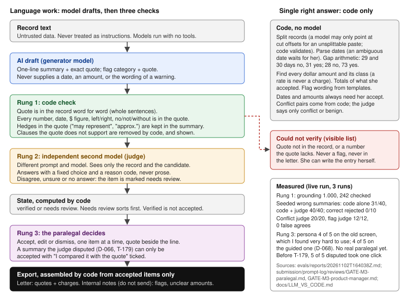

# Part 2: from Zinda's request to a shipped, measured feature

Chris [CHRIS: full name] · Zlayt AI PM project

I built Part 1 with a team of AI agents working a card board I ran. Workers built; reviewer agents playing a paralegal, an adjuster, a staff engineer and others tried to break it. So most of this is how I actually worked, not theory. Receipts are in the repo: 565 review files, 27 eval reports, 75 logged decisions, 56 lessons (at 7471739; tests at 43ce6eb; `submission/evidence/count_at.sh` re-runs the counts).

{width=56%}

**What I'd trade off.** Real calls from this build. I'd make each again.

| Trade | What it cost | Why |
|----------|---------------|-------------------------------|
| Blank service dates over wrong ones (D-073) | She types every service date from the bill | Six review rounds kept finding layouts that printed a wrong date. A wrong date gives the adjuster a reason to doubt every line. A blank can't be wrong. |
| Bills accepted one charge at a time (D-059) | More clicks. No "accept all" for charges | An adjuster reviewer beat our ledger rules three rounds running. A sum of lines a person accepted one by one is the only total I can defend. |
| Drafted treatment paragraph cut (D-067) | She writes the narrative herself | No eval, and its sentences carried no quotes. It comes back when both exist. |
| Full redesign after I found the UI "VERY hard to use" (D-068) | Everything else stopped. One item at a time is slower for an expert than a table | A persona scored it 4/5. I used it and couldn't tell where to start or when I was done. Now: four fixed steps, one question at a time. |
| Ship freeze to finish (D-075) | Polish findings went to the debt list | Serial review rounds were eating the clock. Fix only what makes the demo wrong, crash, leak or mislead. |

## 1. Discovery

**Who first.** The litigation lead who asked, then two or three paralegals, then the attorney who signs the demand. The lead tells me what a mistake costs; the paralegals tell me where the time goes.

> Subject: Treatment chronologies, 30 minutes this week?
>
> [Name], thanks for the ask. Before I build anything I want to see where the time goes and what a mistake costs you. Could I get 30 minutes with you, 20 each with two paralegals who build chronologies, and, if the responsible attorney approves one, a redacted closed matter with its chronology, demand letter and the adjuster's reply? It stays on your systems; I note steps, not content. A week later you get one page: what I saw, what I'd build first, how we'll know it works. Chris

| First three questions for the litigation lead | First three for a paralegal |
|----------------------|----------------------|
| "Take the last demand letter that went out. Where did the chronology hold it up?" | "Walk me through the last chronology you built, from the first record you opened." |
| "Last time an adjuster pushed back on a date or a fact, what did it cost? Days, or dollars off the offer?" | "Which entries do you always re-check against the source? Which one burned you?" |
| "What will you never let software write in a letter? What would you check before you signed one it helped with?" | "When two records disagree or there's a long gap, where do you write that down, and who sees it?" |

**Request versus need.** The request is "faster." The need is faster without a new way to be wrong. I ask for artifacts, not opinions, and compare what people say with what they did. Every time she opens the source to check a line, I mark it. That's the step the tool has to make cheap, not remove.

**Watching real work, with the attorney's sign-off.** A closed file is still client confidential: Texas Rule 1.05 covers former clients too, so "I won't copy anything" isn't the protection. The default is synthetic records, like Part 1, or a redacted copy. A real closed matter only if the responsible attorney picks and approves it first, under the firm's confidentiality agreement; it stays in Zinda's environment, nothing leaves, access is logged. Here I had no access to Zinda's people, so I wrote nine assumptions, each with "what changes if wrong," and had four user-side personas researched (paralegal, litigation lead, legal nurse, adjuster), plus nine for engineering review. A stand-in, not the real thing. [CHRIS: optional, one line on a time you watched real work without exposing customer data.]

*Proof in the repo:* `memory/ASSUMPTIONS.md`, `personas/`

## 2. Prioritization

Chronology goes before demand drafting, deposition summaries and discovery responses:

- **It's upstream.** A letter drafted on an unchecked chronology repeats its errors.
- **It's checkable.** Every output line traces to a source line, so quality is measurable before anyone relies on it: a 73-day gap must flag, a 28-day one must not. Drafted prose is much harder to ground.
- **Mistakes cost most here.** The lead's worry is credibility with adjusters. A demand is a statement to the carrier, and on a Stowers deadline there's no second draft.
- **Every demand needs one; depositions and discovery exist only once a suit is filed.** Most PI matters settle before suit (to confirm with the lead).

What would change my mind:

- A timed baseline shows a hand-built chronology takes under an hour. Then I look elsewhere.
- The lead says adjuster pushback comes from the bills, not the chronology. Billing goes first.
- The lead's hours show deposition summaries or discovery responses eat more paralegal time per matter. They go first.
- Most records arrive as scans. Then intake is the bottleneck and OCR comes first.
- In the pilot, checking the tool's chronology takes as long as writing one. I stop and tell the founders.

*Proof in the repo:* `submission/prompt-log/reviews/T-140-claims-adjuster-r4.md`

## 3. Spec

The user and assumptions (each with "if wrong"); 62 numbered requirements, each with a pass condition and the check that proves it; non-goals; the letter template; the ship bar; and a table of what is code and what is AI. The API contract comes before any code. Three acceptance criteria for the AI:

| # | Acceptance criterion | Checked by |
|--|-------------------|-------------|
| AI-1 | Every timeline entry and every amount in the letter carries a quote that appears word for word in the input. Anything that fails goes to a "could not verify" list and is never exported. | Grounding 1.000, 242 checked |
| AI-2 | Any number, side, negation or hedge in a summary must be in its quote, or the item is marked needs review with the reason. On her own edits it's a hard stop. | Unit tests. Of 40 planted wrong summaries, the code check alone catches 31; the judge catches the other 9 |
| AI-3 **must never** | State a diagnosis, severity or cause the record's own words don't state. Never turn "may represent degenerative change" into "degenerative" or "traumatic." Never merge two accident dates. Never total PT from "$185 per visit." | Golden "must not" rules: 0 hits. Any hit blocks the release |

*Proof in the repo:* `spec/REQUIREMENTS.md`, `docs/LLM_VS_CODE.md`, `memory/contracts/api.md`

## 4. Quality bar

**The test set, from real work product.** Zinda picks about 20 closed matters (clean, messy, scanned, billing-heavy, two crashes); the responsible attorney approves them, not the founders. They never leave Zinda's environment; access is logged; de-identified where practical. The model vendor's terms are reviewed first: no training on our data, a retention limit, a BAA if needed. Client consent where the attorney decides it's required. The senior paralegal's finished chronology is the answer key. A second paralegal marks it independently, and the attorney settles disagreements. Answers are written before any run. I tune on half and look at the other half once per release. Part 1 shows why: golden cases written next to the rules score 1.000 on flags; 15 unfamiliar packets (measured at a74b727; later flag fixes not re-measured) score 0.775 on entries, 0.681 on amounts and 0.81 on flags (34 of 42).

**Who grades.** The paralegal marks every item right, wrong or missing; the attorney grades a sample on "would I sign this?" The checks get graded too, on planted wrong items. Summaries: the code check and the judge together caught 40 of 40 (code alone 31, the judge the other 9). The conflict judge caught 20 of 20, the flag judge 12 of 12, zero false agrees.

**What score means ship** (live run, 3 repeats). Ship means a supervised pilot, not unsupervised use.

| Ship bar | Bar | Part 1 |
|-----|------------------|------------|
| Grounding | 100% of letter statements and amounts quote the input | 1.000 |
| Recall | 95% of entries and amounts | golden 0.982, 1.000; **library 0.775, 0.681** |
| Flags | precision and recall 0.9 per type; 28-day interval no flag, 73-day gap flags | 1.000 golden; 0.81 (34/42) on library packets, a74b727 |
| No invented facts | 0 unsupported statements over 3 runs; code check and judge catch 95% of planted wrong summaries | 0; 40 of 40 together (code alone 31) |
| Reviewable | a paralegal rates "I could verify every claim quickly" 4/5 or better | 4/5, but from a persona, not a real paralegal |

Two honest gaps. Library recall is below the bar, so live use waits (area 5). And the last row: the persona gave the old screen 4/5 too, and I found it very hard to use. The ship call needs a real paralegal on the final screen.

**Catching regressions.** Any change to a prompt, model, phrase list or schema reruns the eval before review. Each report records commit and prompt hashes, and a check fails if they no longer match. Every escaped bug becomes a test case.

*Proof in the repo:* `evals/reports/20261102T164038Z.md`, `evals/reports/library-latest.md`, `evals/golden/`

## 5. Ship and learn

**Rollout.** Stage 0, shadow: on 5 closed matters the attorney approves, each paralegal builds her chronology as usual while the tool builds its own, and we compare. Nothing it makes goes in a letter. Stage 1: two paralegals on live matters (none on a Stowers deadline at first), only once recall on Zinda's own test set meets the bar. Stage 2: the whole team. What I'd send the signing attorney today, on Part 1's numbers:

> Subject: Go on a shadow run, no-go on live matters yet
>
> [Name], where it stands:
>
> - Every letter line and amount quotes the record word for word: 242 of 242. Planted wrong summaries caught by the code check and the AI judge together: 40 of 40 (code alone 31). Diagnoses or causes the record doesn't state: 0.
> - Below the bar: on 15 unfamiliar packets it found 78% of treatment entries and 68% of charges (bar: 95%), and 34 of 42 warnings (measured at a74b727). Trusted, that means missed visits and an under-stated demand, so the paralegals still read every record and bill.
>
> So: go on a shadow run on 5 closed matters you pick, inside our environment. Their records go to [vendor] under terms you've reviewed: no training on our data, [N]-day retention. Whether our engagement letters cover that, or clients must consent, is your call. Live matters wait until recall on our own test set meets the bar; then I ask again. Once live, the paralegals check each line against its quote before accepting it, and you check the letter lines against their quotes before you sign, all of them at first, then a sample we agree on. Texas Opinion 705 says the lawyer always verifies AI output. The tool makes that check fast; it never replaces it. One unsupported fact in a draft and we pause. One that reaches a carrier and we stop; you hear that day, and you decide the correction. Yes, no, or "yes, but" by Thursday? Chris

**Feedback.** A 20-minute weekly check-in per paralegal, plus the audit log: every accept, edit and dismiss, with before and after, so I see where it was wrong without asking.

| Measure | Definition | Expand if | Kill if |
|----|----------|-------|-------|
| Adoption | Share of demand letters whose chronology started in the tool | 60% after 20 matters | under 25% after 6 weeks of fixes |
| Time saved | Median minutes, first paste to copied letter section, against her last three by hand | down 30% | down under 10% after 6 weeks |
| Output quality | Errors that escaped, per 100 letter lines (found by the attorney or an adjuster); needs-review items accepted unchanged (over 90% with an escaped error: she's rubber-stamping, I add friction; under 50%: warnings are noise, I tune the lexicon) | 0 escaped | **one** unsupported fact reaches a carrier: stop, attorney told that day |
| Retention | Paralegals using it on 2+ matters in week 8, of those active in week 4 | 80% | under 50% |

My starting numbers; the lead and I agree them in week 1. Then the cheapest fix that moves the weakest number. At OutSystems the AI Agent Builder reached about 80% adoption. [CHRIS: optional, one line on how you measured that adoption.]

*Proof in the repo:* `app/backend/store.py` (audit log), `spec/REQUIREMENTS.md` section 7

## 6. Operating rhythm and fast decisions

| I decide alone, same day | I decide with the litigation lead | A founder decides |
|-------|---------|---------|
| Wording, queue order, which eval cases to add, bug triage, a scope cut inside a feature | Anything that changes what leaves the firm in a letter, and what counts as an error | Spend and vendors, public exposure, expand or kill. Using real client data: the responsible attorney, never a founder |

**Engineering** decides how: stack, which model runs where inside the budget, test design, build or buy. Engineering has a "not safe to ship" veto I can't overrule; only a founder can, in writing. I decide what and when. We draw the AI-versus-code line together and write it down. Disagreements get settled by evidence first: write the test that shows who's right. Still open? The safer answer holds for anything the carrier sees. In this build a staff-engineer reviewer held one card (T-177) through five review rounds before passing it, and was right to. [CHRIS: confirm or change this stance (NEEDS_CHRIS #11).]

**Speed.** Every founder question is one line, with my default:

> Need a yes or no by Thursday: OK to sign [vendor]'s no-training, short-retention terms? The attorney needs them before approving the shadow matters. If I don't hear back, we shadow on synthetic records and lose a week.

Expect an answer in one business day, three for a vendor or spend call. No answer, and a reversible default goes ahead and gets logged.

**First 30 days.** Week 1: shadow three paralegals and the attorney; start assumptions, decision log and board. Week 2: timed baselines; pick and mark up the 20 matters. Week 3: spec and API contract signed off; first slice on the test set. Week 4: ship-bar run, shadow stage, go or no-go for stage 1.

*Proof in the repo:* `memory/ORCHESTRATOR_DECISIONS.md`, `submission/NEEDS_CHRIS.md`

## 7. Communicating with the team

**Honest feedback from busy people.** I don't ask whether they like it. I put output in front of them and ask them to find the error. I sit with paralegals without the lead in the room; people say less in front of whoever assigns their work.

> Subject: 20 minutes on one chronology?
>
> Hi [name], I'm building the tool that drafts treatment chronologies, and I need to hear where it's wrong, not whether it's nice. 20 minutes at your desk this week? Build a chronology the way you normally do while I watch, from the redacted closed matter [attorney] cleared for this. It stays on Zinda's system. Then you mark up one the tool made. If this week is bad, just say "not this week." Chris

**The find-the-error ask**, handed over with a printed chronology:

> This one's from a synthetic packet built like ours. I planted five mistakes in it, mixed in with whatever the tool got wrong on its own. Circle every line you wouldn't put in a letter. Ten minutes. Don't be nice.

**Agenda, 30 minutes, one paralegal.** 0-3: why I'm here, and which records we use (synthetic, or the matter [attorney] cleared). 3-13: you walk me through it. 13-23: you mark the tool's chronology, lines you'd trust and lines you wouldn't, and why. 23-28: what would make you stop using it. 28-30: what I'll change, and when you'll hear back.

**Unhappy, silent, or conflicting.** Unhappy: reproduce it with her, in the room; say what changes and by when; close the loop in writing that week. Silent: read the audit log, then ask about one specific item, never "any feedback?" Conflicting: whoever signs the letter decides what goes in it; whoever does the work decides how it flows. I tell both what I decided and why. In this build a paralegal reviewer blocked the first spec because accepted warnings would have reached the carrier. Now accepting a warning means "I've seen it," and warnings live in internal notes.

**Founders, without more meetings.** One page every Friday and a decision log they can read any time. No standing meeting. An example, with made-up pilot numbers:

> **Friday, pilot week 3.** Adoption: 7 of 11 letters started in the tool. Time: median 52 min to 31. Quality: 0 escaped errors; 81% of needs-review items accepted unchanged. Retention: 2 of 2 paralegals still in. Need from you: OK to add a third paralegal Monday? Default yes. Risk: one hospital sends scans, and recall drops there.

*Proof in the repo:* `memory/STATE.md`, `memory/ORCHESTRATOR_DECISIONS.md` (D-001)

## 8. Supervising developers

**Before they start:** spec, API contract, golden set, AI-versus-code table, non-goals, and a card per task whose acceptance criteria name the exact check. Can't say how it gets tested? Don't start. A real card, trimmed:

> **T-202 (P0, backend). Letter charge lines show the date of service, not the bill's statement date.** Done when: on case_09, lib14 and lib10 the letter shows the service date or period; `evals/letter_check.py` checks every dated charge line's date against its own quote, across all 25 cases; unit and end-to-end tests pass from a clean archive of the commit.

**Each week:** the board, this eval report against the last, escaped bugs, review findings by severity, decisions waiting on me. Evidence, not claims: a worker's "12/12 pass" came from uncommitted files, so now everything is verified from a clean copy of the commit.

**When a review finds a blocker.** After the sixth round on T-202, here is how I'd put it to a human developer. (The agent got a terser brief, transcript 2026-11-03T13:13.)

> Dates aren't shipping. Six rounds in, review still finds layouts that print a wrong date: a visit note lending its date to another visit's charge, a UB-04 period overriding a line's own date. In a demand letter a wrong date is worse than a blank. The adjuster uses it to doubt every other line, and she can't tell which to re-check. So we take the fallback: every charge line prints "date of service [__________] (record dated X)" and she fills it from the bill. Pull date extraction from the letter, keep the tests that pinned the bad patterns, scope cut 28 covers it. We can't prove the rule, so it doesn't go out.

Next time the fallback goes in the card on day one, not after round four.

**Before release:** full unit and end-to-end suites on a clean copy of the commit (5,945 and 614 passed, 0 failed, at 43ce6eb), the letter check at 0, the live eval, a timed clean-clone install, and adversarial reviewers. **Sign-off:** a reviewer in a fresh context who didn't write the work, then me. Workers never close their own cards. All six milestone gates passed; M3 and the combined M3 and M4 panel each failed once first.

**Late work, or a bug in front of users.** Late: cut scope, not checks. A bug in front of users: stop, reproduce, write the failing test, fix, record the lesson. Example: the demo labeled answers we prepared as AI output; five rounds to fix. [CHRIS: optional, one line on a late feature you supervised and what you cut.]

**AI used:** to build, draft and red-team. AI drafts; I decide the ship bar and the AI-versus-code line. **Not used:** to approve its own work, talk to users, or send anything.

*Proof in the repo:* `board/cards/T-202.md`, `artifacts/gate-M3M4-suite-final.txt`, `memory/LESSONS.md`

## The one story: a miss

> [CHRIS: write this yourself. It has to be a feature or launch you owned that missed the mark. About 200 words.]
>
> 1. What you shipped and what you expected.
> 2. What you missed, and the number or signal that showed it.
> 3. One concrete change to your process: an artifact or a rule, not "communicate more."
> 4. How it shows up here (hooks: the "must never" criterion; golden 1.000 vs library 0.81; the persona score).
